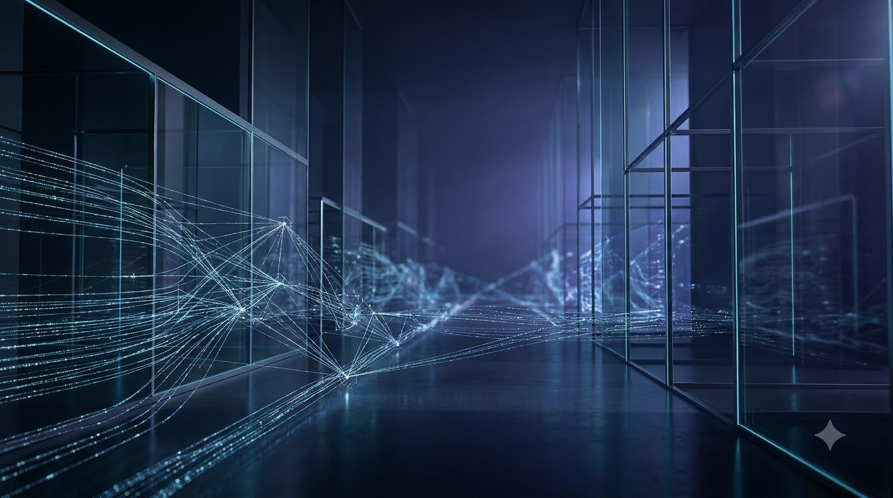

# IMAGE GENERATION GUIDE — GOOGLE FLOW MASTER PROMPTS
## IT COMPANY — Complete Corporate Website Visual Asset Blueprint

> **ENGINEERING DIGITAL SOLUTIONS. POWERING WHAT'S NEXT.**  
> This document is the definitive master image generation guide for all 57 visual asset placeholders across all 24 pages of the **IT COMPANY** corporate website. Every prompt is formulated specifically for **Google Flow** (and compatible enterprise image synthesis pipelines like Imagen 3), adhering strictly to the brand visual system: `#080D18` midnight navy, `#4F8CFF` electric blue, `#36D6E8` vibrant cyan, and `#9B7BFF` violet accents.

---

## 1. Summary Statistics

| Metric | Count | Details |
| :--- | :--- | :--- |
| **Total Image Assets** | **57** | 100% matched to HTML `.placeholder-badge` elements |
| **Landscape (16:9)** | **24** | Hero headers, broad panoramic technology visuals (`1920 × 1080 px`) |
| **Landscape (16:10)** | **22** | Portfolio cards, case studies, blog article covers, solution blocks (`1440 × 900 px`) |
| **Landscape (4:3)** | **10** | Architecture diagrams, philosophy, methodology & sidebars (`1200 × 900 px`) |
| **Portrait (9:16)** | **1** | Mobile application interface mockup (`1080 × 1920 px`) |
| **Square (1:1)** | **0** | (All cards engineered with standard responsive rectangular aspect ratios) |

---

## 2. Universal Global Style & Negative Prompts

### Global Aesthetic Guidelines
- **Visual Genre:** Photorealistic cinematic enterprise technology; high-end European SaaS and Silicon Valley digital studio aesthetic.
- **Lighting:** Moody dark environment with crisp luminescent linear illumination, volumetric rim lighting, subtle refraction, and controlled glows.
- **Color Temperature:** Cool oceanic dark base (`#080D18`, `#101827`) energized by electric blue (`#4F8CFF`), cyan neon highlights (`#36D6E8`), and rare deep violet highlights (`#9B7BFF`).
- **Realism:** Crisp optical textures, genuine depth-of-field bokeh, glass refraction, physical hardware realism, architectural accuracy.

### Universal Negative Prompt (Apply to All Generations)
```text
text, typography, watermark, logo, words, letters, signatures, blurry, low resolution, oversaturated neon, cartoonish, 3d render toy, cheap plastic, distorted faces, extra fingers, malformed hands, messy wires, cluttered messy desk, floating blue holograms everywhere, generic stock handshake, cheesy corporate smiling models, 90s server room tropes
```

---

## 3. Recommended Generation Order

1. **Tier 1 (Core Brand Anchor):** Image #01 (`home-hero-technology.jpg`) — Establish foundational lighting and palette coherence.
2. **Tier 2 (Primary Service Heroes):** Images #10, #12, #13, #15, #17, #19, #20, #21, #23, #24, #26, #28, #30, #32, #33, #34.
3. **Tier 3 (Featured Work & Case Studies):** Images #07–#09, #36–#45.
4. **Tier 4 (Blog Covers):** Images #48–#55.
5. **Tier 5 (Secondary & Conversion Support):** Images #02–#06, #11, #14, #16, #18, #22, #25, #27, #29, #31, #35, #46, #47, #56, #57.

---

## 4. Complete Image Asset Catalog & Google Flow Prompts

---

### PAGE 01: `index.html` (Homepage)

#### Image #01: `home-hero-technology.jpg`
- **Page & Section:** `index.html` — Section 1: Hero
- **Aspect Ratio & Resolution:** `16:9` (`1920 × 1080 px`)
- **Orientation:** Landscape
- **Visual Role:** High-impact hero background visual communicating world-class technology engineering.
- **Google Flow Prompt:**
  ```text
  Subject: Abstract high-tech digital infrastructure network with subtle architectural glass reflections, fiber-optic data channels, and delicate illuminated geometric nodes.
  Environment: Premium minimalist dark technology studio with expansive spatial depth, subtle dark navy atmospheric haze.
  Composition: Wide-angle cinematic landscape shot, rule of thirds, smooth receding perspective lines extending toward infinity, sharp focal foreground fading into creamy soft bokeh.
  Lighting: Dual-tone rim lighting, crisp cyan (#36D6E8) edge highlights, subtle deep violet (#9B7BFF) atmospheric glow, deep shadows.
  Color Palette: Midnight navy (#080D18), dark slate (#101827), electric blue (#4F8CFF), glowing cyan (#36D6E8).
  Style: Photorealistic, cinematic 8k, modern enterprise technology, clean and uncluttered.
  Mood: Innovative, visionary, enterprise-grade, authoritative.
  Aspect Ratio: 16:9
  ```
- **Negative Prompt:** Use Universal Negative Prompt.

---

#### Image #02: `home-intro-collaboration.jpg`
- **Page & Section:** `index.html` — Section 2: Introduction ("Technology Built Around Your Business")
- **Aspect Ratio & Resolution:** `4:3` (`1200 × 900 px`)
- **Orientation:** Landscape
- **Visual Role:** Professional engineering team collaboration in a modern architectural technology hub.
- **Google Flow Prompt:**
  ```text
  Subject: Software engineers and system architects reviewing code architecture on dual ultra-wide curved monitors, focused professional collaboration.
  Environment: Modern dark architectural technology laboratory with glass partitions, brushed aluminum details, and subtle ambient ceiling LED strips.
  Composition: Medium shot from an oblique angle, shallow depth of field, sharp focus on engineering discussion, natural body language.
  Lighting: Soft diffused directional key light, subtle cyan back-glow reflecting off glass desk surfaces.
  Color Palette: Charcoal, midnight blue, electric blue accent reflections, matte black.
  Style: Editorial documentary photography, authentic enterprise workplace, ultra-crisp optics.
  Mood: Serious, collaborative, intelligent, professional.
  Aspect Ratio: 4:3
  ```
- **Negative Prompt:** Use Universal Negative Prompt.

---

#### Image #03: `home-deliver-digital-products.jpg`
- **Page & Section:** `index.html` — Section 5: Solutions ("Digital Products")
- **Aspect Ratio & Resolution:** `16:10` (`1440 × 900 px`)
- **Orientation:** Landscape
- **Visual Role:** Visualizing high-polish SaaS product design and consumer digital experience engineering.
- **Google Flow Prompt:**
  ```text
  Subject: Sleek dark-mode tablet device resting on a slate surface displaying polished UI wireframes, design token layouts, and user experience components.
  Environment: Minimalist product design studio workspace, matte stone desk, ambient soft studio backdrop.
  Composition: High-angle 45-degree isometric perspective, tight framing, selective depth of field focusing on crisp UI cards.
  Lighting: Soft directional studio strobe, delicate electric blue glow accents on screen edges.
  Color Palette: Deep charcoal, midnight navy, electric blue (#4F8CFF), crisp white UI elements.
  Style: Commercial product photography, elegant minimalism, premium SaaS aesthetic.
  Mood: Sophisticated, creative, precision-crafted, sleek.
  Aspect Ratio: 16:10
  ```
- **Negative Prompt:** Use Universal Negative Prompt.

---

#### Image #04: `home-deliver-enterprise-software.jpg`
- **Page & Section:** `index.html` — Section 5: Solutions ("Enterprise Software")
- **Aspect Ratio & Resolution:** `16:10` (`1440 × 900 px`)
- **Orientation:** Landscape
- **Visual Role:** Depicting resilient enterprise backend architectures and high-scale operational platforms.
- **Google Flow Prompt:**
  ```text
  Subject: Enterprise data center server blades with organized structured fiber cabling, glowing status LEDs, and brushed metal server chassis.
  Environment: State-of-the-art enterprise cloud facility, reflective anti-static floor, polished server racks fading in perspective.
  Composition: Low-angle dramatic perspective down a server corridor, deep focal depth, crisp textural detail on aluminum rack faces.
  Lighting: Cool cyan LED rack illumination, electric blue optical line pulses, high-contrast dark environment.
  Color Palette: Deep navy (#080D18), gunmetal gray, vibrant cyan (#36D6E8), pure blue (#4F8CFF).
  Style: High-end architectural tech photography, clean cable management, hyper-detailed.
  Mood: Scalable, rock-solid, secure, enterprise-grade.
  Aspect Ratio: 16:10
  ```
- **Negative Prompt:** Use Universal Negative Prompt.

---

#### Image #05: `home-deliver-automation.jpg`
- **Page & Section:** `index.html` — Section 5: Solutions ("Intelligent Automation")
- **Aspect Ratio & Resolution:** `16:10` (`1440 × 900 px`)
- **Orientation:** Landscape
- **Visual Role:** Visualizing automated data pipelines, robotic workflows, and autonomous process loops.
- **Google Flow Prompt:**
  ```text
  Subject: Dynamic abstract visualization of data stream pipelines converging into a central automated processing core, geometric workflow pathways.
  Environment: Virtual data architecture space, dark volumetric glass floor with subtle reflection.
  Composition: Centered symmetrical composition, dynamic forward motion, shallow focus highlighting automated convergence points.
  Lighting: Luminescent cyan and violet neon light tubes casting subtle glowing reflections on dark glassy planes.
  Color Palette: Midnight background (#080D18), cyan (#36D6E8), violet accent (#9B7BFF).
  Style: Architectural 3D abstract visualization, clean lines, photorealistic material shaders.
  Mood: Fast, automated, seamless, intelligent.
  Aspect Ratio: 16:10
  ```
- **Negative Prompt:** Use Universal Negative Prompt.

---

#### Image #06: `home-deliver-business-tech.jpg`
- **Page & Section:** `index.html` — Section 5: Solutions ("Business Technology Solutions")
- **Aspect Ratio & Resolution:** `16:10` (`1440 × 900 px`)
- **Orientation:** Landscape
- **Visual Role:** Representing holistic business intelligence, operational consulting, and IT leadership.
- **Google Flow Prompt:**
  ```text
  Subject: Executive technology briefing room with large translucent digital architectural wall displaying system topologies and milestone metrics.
  Environment: High-rise glass corporate boardroom overlooking a dusk city skyline with subtle blue ambient evening light.
  Composition: Wide interior perspective, architectural framing, silhouettes of technology consultants analyzing plans.
  Lighting: Ambient blue dusk sky light combined with cool white backlighting from digital display glass.
  Color Palette: Deep blue tones, charcoal shadows, soft white illumination, subtle cyan highlights.
  Style: Architectural interior photography, corporate editorial, cinematic glass reflections.
  Mood: Strategic, visionary, prestigious, executive.
  Aspect Ratio: 16:10
  ```
- **Negative Prompt:** Use Universal Negative Prompt.

---

#### Image #07: `home-project-01-ecommerce.jpg`
- **Page & Section:** `index.html` — Section 9: Featured Projects (Demo Project 01)
- **Aspect Ratio & Resolution:** `16:10` (`1440 × 900 px`)
- **Orientation:** Landscape
- **Visual Role:** High-volume e-commerce infrastructure and digital retail fulfillment platform.
- **Google Flow Prompt:**
  ```text
  Subject: Modern automated warehouse logistics management screen mockups integrated with high-tech fulfillment robots and conveyor tracking sensors.
  Environment: Dark automated logistics hub with linear ceiling lights and smart scanner beacons.
  Composition: Split perspective blending sleek dark UI dashboard with real-world automated logistics conveyor in soft background focus.
  Lighting: Crisp directional LED overhead bars, cyan status sensor lights.
  Color Palette: Dark slate, carbon gray, electric blue (#4F8CFF), vivid cyan indicators.
  Style: Industrial tech photography, clean commercial grade, sharp focus.
  Mood: Efficient, high-throughput, modern, reliable.
  Aspect Ratio: 16:10
  ```
- **Negative Prompt:** Use Universal Negative Prompt.

---

#### Image #08: `home-project-02-bi-dashboard.jpg`
- **Page & Section:** `index.html` — Section 9: Featured Projects (Demo Project 02)
- **Aspect Ratio & Resolution:** `16:10` (`1440 × 900 px`)
- **Orientation:** Landscape
- **Visual Role:** Executive financial intelligence dashboard with real-time multi-dimensional vector metrics.
- **Google Flow Prompt:**
  ```text
  Subject: Ultra-clean dark analytics dashboard on a high-resolution frameless monitor, displaying financial yield curves, cohort matrices, and telemetry graphs.
  Environment: Executive trading and fintech analytics office, dark walnut desk, soft ambient wall glow.
  Composition: Close-up angled view of workstation display, 35mm lens, sharp detail on UI cards and vector graphs.
  Lighting: Soft glow radiating from the monitor screen illuminating desktop textures, subtle cyan accent back-lighting.
  Color Palette: Deep background (#101827), electric blue metrics (#4F8CFF), cyan indicators (#36D6E8), violet markers (#9B7BFF).
  Style: Macro technology photography, crisp software interface, modern fintech aesthetic.
  Mood: Quantitative, analytical, precise, trustworthy.
  Aspect Ratio: 16:10
  ```
- **Negative Prompt:** Use Universal Negative Prompt.

---

#### Image #09: `home-project-03-telehealth.jpg`
- **Page & Section:** `index.html` — Section 9: Featured Projects (Demo Project 03)
- **Aspect Ratio & Resolution:** `16:10` (`1440 × 900 px`)
- **Orientation:** Landscape
- **Visual Role:** Compliant telehealth and medical diagnostic platform with patient telemetry monitoring.
- **Google Flow Prompt:**
  ```text
  Subject: High-resolution medical telemetry tablet device displaying heart rate waveforms, patient diagnostic timeline, and secure biometric verification indicators.
  Environment: Clean contemporary clinical research lab, frosted medical glass partitions in soft bokeh.
  Composition: Isometric tabletop shot, clinical precision, soft vignette framing.
  Lighting: Clean daylight balanced key light combined with soft cyan digital screen illumination.
  Color Palette: Slate gray, clinical white accents, calming cyan (#36D6E8), navy shadows.
  Style: Modern medical technology photography, clean, sterile, high-end HealthTech.
  Mood: Empathetic, secure, technologically advanced, trustworthy.
  Aspect Ratio: 16:10
  ```
- **Negative Prompt:** Use Universal Negative Prompt.

---

### PAGE 02: `about.html` (About the Company)

#### Image #10: `about-hero-vision.jpg`
- **Page & Section:** `about.html` — Page Hero / Corporate Vision
- **Aspect Ratio & Resolution:** `16:9` (`1920 × 1080 px`)
- **Orientation:** Landscape
- **Visual Role:** Corporate technological vision and engineering culture.
- **Google Flow Prompt:**
  ```text
  Subject: Architectural glass atrium of an international technology research institute with software engineers walking across elevated bridges.
  Environment: Futuristic sustainable architecture, geometric steel framing, ambient blue skylight, polished dark concrete floor.
  Composition: Expansive architectural perspective, symmetrical leading lines, people in motion blur creating a sense of forward momentum.
  Lighting: Natural ambient dusk light mixed with linear cyan architectural strip lighting.
  Color Palette: Midnight navy (#080D18), dark titanium, cyan highlights (#36D6E8), cool white accents.
  Style: Architectural photography, cinematic wide lens, clean Scandinavian enterprise aesthetic.
  Mood: Visionary, institutional, forward-thinking, prestigious.
  Aspect Ratio: 16:9
  ```
- **Negative Prompt:** Use Universal Negative Prompt.

---

#### Image #11: `about-philosophy-engineering.jpg`
- **Page & Section:** `about.html` — Technology Philosophy & Development Principles
- **Aspect Ratio & Resolution:** `4:3` (`1200 × 900 px`)
- **Orientation:** Landscape
- **Visual Role:** Representing precision engineering standards, quality assurance, and code craftsmanship.
- **Google Flow Prompt:**
  ```text
  Subject: Close-up macro view of microchip silicon wafer architecture with laser-etched circuitry pathways and precision gold contact pins.
  Environment: High-tech semiconductor cleanroom laboratory, sterile dark ambient atmosphere.
  Composition: Macro extreme close-up, shallow depth of field, striking crystalline geometric patterns.
  Lighting: Dual directional grazing light, electric blue highlights skimming across metallic wafer surfaces, violet shadow fills.
  Color Palette: Dark obsidian, cobalt blue, electric cyan (#36D6E8), violet accent (#9B7BFF).
  Style: Scientific macro photography, ultra-high detail, pristine micro-engineering.
  Mood: Rigorous, disciplined, immaculate, cutting-edge.
  Aspect Ratio: 4:3
  ```
- **Negative Prompt:** Use Universal Negative Prompt.

---

### PAGE 03: `services.html` (All IT Services Directory)

#### Image #12: `services-overview-ecosystem.jpg`
- **Page & Section:** `services.html` — Page Hero / Services Ecosystem
- **Aspect Ratio & Resolution:** `16:9` (`1920 × 1080 px`)
- **Orientation:** Landscape
- **Visual Role:** Visualizing an interconnected ecosystem of software, cloud, data, and security services.
- **Google Flow Prompt:**
  ```text
  Subject: Abstract 3D interconnected ecosystem of modular technology nodes, data cubes, and cloud link pathways floating harmoniously in space.
  Environment: Dark limitless digital space with subtle volumetric grid planes in the distant perspective.
  Composition: Cinematic 16:9 landscape, golden ratio balance, central node cluster with radiating functional orbits.
  Lighting: Internal luminescent glow from translucent cubes, electric blue and cyan edge refraction.
  Color Palette: Deep navy (#080D18), dark slate (#101827), cyan (#36D6E8), electric blue (#4F8CFF), violet (#9B7BFF).
  Style: Photorealistic 3D digital art, glassmorphism materials, refractive optics, clean and crisp.
  Mood: Comprehensive, integrated, intelligent, modular.
  Aspect Ratio: 16:9
  ```
- **Negative Prompt:** Use Universal Negative Prompt.

---

### PAGE 04: `software-development.html` (Custom Software Development)

#### Image #13: `software-dev-hero-architecture.jpg`
- **Page & Section:** `software-development.html` — Page Hero
- **Aspect Ratio & Resolution:** `16:9` (`1920 × 1080 px`)
- **Orientation:** Landscape
- **Visual Role:** Scalable enterprise software architecture and microservices design.
- **Google Flow Prompt:**
  ```text
  Subject: Abstract multi-tier software system architecture visualization, structured modular layers, API gateway pathways, and service communication meshes.
  Environment: Dark virtual architecture studio, polished reflective dark surface.
  Composition: Wide isometric elevation view, pristine alignment, clean geometric hierarchy.
  Lighting: Soft linear blue luminescence, crisp cyan accent outlines on active service modules.
  Color Palette: Midnight navy (#080D18), deep blue, electric cyan, violet connector lines.
  Style: Modern technical conceptual art, architectural rigor, photorealistic rendering.
  Mood: Scalable, robust, meticulously engineered, enterprise-grade.
  Aspect Ratio: 16:9
  ```
- **Negative Prompt:** Use Universal Negative Prompt.

---

#### Image #14: `software-dev-lifecycle-code.jpg`
- **Page & Section:** `software-development.html` — Engineering Approach
- **Aspect Ratio & Resolution:** `4:3` (`1200 × 900 px`)
- **Orientation:** Landscape
- **Visual Role:** Code craftsmanship, automated CI/CD pipeline, and unit testing rigor.
- **Google Flow Prompt:**
  ```text
  Subject: Multiple curved frameless monitors in an engineering command station showing clean dark-themed code editor with automated unit test passes.
  Environment: Minimalist software engineering office at night, ergonomic setup, warm indirect accent lighting.
  Composition: Over-the-shoulder medium shot, shallow depth of field, sharp monitor focus.
  Lighting: Soft blue and cool white screen glow illuminating hands on mechanical keyboard.
  Color Palette: Dark charcoal, electric blue, syntax green and cyan highlights.
  Style: Professional tech lifestyle photography, authentic developer environment.
  Mood: Focused, productive, high-craft, dependable.
  Aspect Ratio: 4:3
  ```
- **Negative Prompt:** Use Universal Negative Prompt.

---

### PAGE 05: `web-development.html` (Web Development & Portals)

#### Image #15: `web-dev-hero-cloud-portal.jpg`
- **Page & Section:** `web-development.html` — Page Hero
- **Aspect Ratio & Resolution:** `16:9` (`1920 × 1080 px`)
- **Orientation:** Landscape
- **Visual Role:** Cloud web portals, progressive web apps, and enterprise web solutions.
- **Google Flow Prompt:**
  ```text
  Subject: Layered floating web application browser interfaces showing responsive responsive dashboard components, user management portals, and cloud integrations.
  Environment: Dark futuristic studio with subtle light refractions passing through translucent glass browser windows.
  Composition: Multi-layered floating perspective, dynamic stagger, crisp edge bevels.
  Lighting: Grazing cyan edge lighting, soft electric blue back-glow.
  Color Palette: Dark navy (#080D18), glass white, electric blue (#4F8CFF), cyan (#36D6E8).
  Style: Premium digital UI rendering, high-end SaaS product reveal, ultra-clean materials.
  Mood: Modern, responsive, interactive, elegant.
  Aspect Ratio: 16:9
  ```
- **Negative Prompt:** Use Universal Negative Prompt.

---

#### Image #16: `web-dev-responsive-interface.jpg`
- **Page & Section:** `web-development.html` — Responsive Architecture
- **Aspect Ratio & Resolution:** `16:10` (`1440 × 900 px`)
- **Orientation:** Landscape
- **Visual Role:** Cross-device responsive coherence across desktop, tablet, and mobile browsers.
- **Google Flow Prompt:**
  ```text
  Subject: Seamless device family arrangement (laptop, tablet, and smartphone) displaying synchronized responsive web portal layouts.
  Environment: Premium minimalist design studio desk with concrete and brushed aluminum finishes.
  Composition: Group product composition, 50mm lens, harmonious device spacing, crystal-clear screens.
  Lighting: Soft diffused daylight from side window with cool cyan fill light.
  Color Palette: Aluminum silver, dark slate, deep blue, vibrant cyan accents on screens.
  Style: Studio commercial hardware photography, pristine industrial design.
  Mood: Adaptive, unified, polished, accessible.
  Aspect Ratio: 16:10
  ```
- **Negative Prompt:** Use Universal Negative Prompt.

---

### PAGE 06: `mobile-app-development.html` (Mobile App Development)

#### Image #17: `mobile-dev-hero-devices.jpg`
- **Page & Section:** `mobile-app-development.html` — Page Hero
- **Aspect Ratio & Resolution:** `16:9` (`1920 × 1080 px`)
- **Orientation:** Landscape
- **Visual Role:** High-performance iOS and Android mobile engineering.
- **Google Flow Prompt:**
  ```text
  Subject: Two sleek bezel-less flagship smartphones floating gracefully in dark space, displaying dark-mode mobile application interfaces with interactive charts.
  Environment: Minimalist dark void with subtle orbital light rings and soft depth particle haze.
  Composition: Dynamic dual-phone composition, dramatic angle, crisp reflections on curved glass edges.
  Lighting: Edge rim lighting in electric blue and cyan, subtle violet backlight.
  Color Palette: Matte black, electric blue (#4F8CFF), neon cyan (#36D6E8), violet accents (#9B7BFF).
  Style: Commercial flagship device photography, ultra-clean glass and ceramic textures.
  Mood: Agile, high-performance, intuitive, mobile-first.
  Aspect Ratio: 16:9
  ```
- **Negative Prompt:** Use Universal Negative Prompt.

---

#### Image #18: `mobile-dev-screen-mockup.jpg`
- **Page & Section:** `mobile-app-development.html` — Interactive Mobile Screen Mockup
- **Aspect Ratio & Resolution:** `9:16` (`1080 × 1920 px`)
- **Orientation:** Portrait
- **Visual Role:** Detailed vertical mobile UI architecture showing real-time mobile app workflow.
- **Google Flow Prompt:**
  ```text
  Subject: Complete vertical screen view of a high-end enterprise mobile application, featuring biometric login badge, transaction stream cards, and telemetry status.
  Environment: Frameless vertical presentation, clean dark glass UI canvas with subtle inner border glow.
  Composition: Direct frontal view, perfectly centered, pixel-precise typography and iconography layout.
  Lighting: Self-illuminating OLED black screen aesthetic with vibrant cyan (#36D6E8) and electric blue (#4F8CFF) UI highlights.
  Color Palette: Pure OLED black, deep navy (#101827), electric blue, bright cyan, emerald status dots.
  Style: High-fidelity mobile UI design presentation, crisp vector-grade render.
  Mood: Intuitive, cutting-edge, secure, user-centric.
  Aspect Ratio: 9:16
  ```
- **Negative Prompt:** Use Universal Negative Prompt.

---

### PAGE 07: `ai-solutions.html` (Artificial Intelligence Solutions)

#### Image #19: `ai-solutions-hero-neural-network.jpg`
- **Page & Section:** `ai-solutions.html` — Page Hero
- **Aspect Ratio & Resolution:** `16:9` (`1920 × 1080 px`)
- **Orientation:** Landscape
- **Visual Role:** Enterprise AI, neural network intelligence, and deep learning architectures.
- **Google Flow Prompt:**
  ```text
  Subject: Intricate 3D neural network lattice with glowing synaptic nodes, tensor data pathways, and multidimensional vector embeddings connecting seamlessly.
  Environment: Expansive dark cognitive computing space, deep atmospheric perspective.
  Composition: Sweeping panoramic landscape, dynamic diagonal energy flow, sharp focal plane through central neural cluster.
  Lighting: Luminescent cyan and violet synaptic pulses radiating soft volumetric glow through dark haze.
  Color Palette: Deep midnight navy (#080D18), brilliant cyan (#36D6E8), electric blue (#4F8CFF), soft violet (#9B7BFF).
  Style: Scientific visualization, high-resolution generative conceptual rendering, sophisticated and elegant.
  Mood: Intelligent, transformative, complex, awe-inspiring.
  Aspect Ratio: 16:9
  ```
- **Negative Prompt:** Use Universal Negative Prompt.

---

### PAGE 08: `ai-automation.html` (AI & Business Automation)

#### Image #20: `ai-automation-hero-robotics.jpg`
- **Page & Section:** `ai-automation.html` — Page Hero
- **Aspect Ratio & Resolution:** `16:9` (`1920 × 1080 px`)
- **Orientation:** Landscape
- **Visual Role:** Autonomous workflows, robotic process automation, and intelligent enterprise orchestration.
- **Google Flow Prompt:**
  ```text
  Subject: High-precision robotic automation arm working in tandem with digital light streams and optical sensor arrays, executing flawless process automation.
  Environment: Advanced automated smart facility, dark architectural setting with linear ceiling LED tracks.
  Composition: Cinematic 16:9 landscape framing, low-angle perspective emphasizing robotic precision and speed.
  Lighting: High-contrast dramatic rim lighting, electric blue laser calibration lines, cyan indicator rings.
  Color Palette: Carbon fiber black, brushed steel, electric blue (#4F8CFF), glowing cyan (#36D6E8).
  Style: Industrial robotics photography, cinematic realism, 8k crisp mechanical details.
  Mood: Efficient, relentless, autonomous, error-free.
  Aspect Ratio: 16:9
  ```
- **Negative Prompt:** Use Universal Negative Prompt.

---

### PAGE 09: `cloud-services.html` (Cloud Computing & DevOps)

#### Image #21: `cloud-services-hero-datacenter.jpg`
- **Page & Section:** `cloud-services.html` — Page Hero
- **Aspect Ratio & Resolution:** `16:9` (`1920 × 1080 px`)
- **Orientation:** Landscape
- **Visual Role:** Hyperscale cloud infrastructure, multi-region redundancy, and serverless clusters.
- **Google Flow Prompt:**
  ```text
  Subject: Symmetrical corridor inside a hyperscale cloud data center with rows of illuminated server cabinets receding into infinity.
  Environment: Tier-4 high-security data center, pristine reflective raised flooring, overhead cabling trays.
  Composition: One-point central perspective, wide-angle lens, architectural symmetry and scale.
  Lighting: Linear cool white ceiling LEDs combined with glowing blue and green server telemetry rack lights.
  Color Palette: Deep navy shadows, titanium gray, brilliant electric blue (#4F8CFF), clean cyan highlights.
  Style: Architectural industrial photography, hyper-crisp optics, spotless modern engineering.
  Mood: Resilient, limitless, redundant, mission-critical.
  Aspect Ratio: 16:9
  ```
- **Negative Prompt:** Use Universal Negative Prompt.

---

#### Image #22: `cloud-services-devops-pipeline.jpg`
- **Page & Section:** `cloud-services.html` — Infrastructure as Code & Continuous Delivery
- **Aspect Ratio & Resolution:** `4:3` (`1200 × 900 px`)
- **Orientation:** Landscape
- **Visual Role:** DevOps continuous integration, container orchestration (Kubernetes/Docker), and GitOps.
- **Google Flow Prompt:**
  ```text
  Subject: Conceptual 3D visualization of containerized software pods moving along an automated continuous integration pipeline with automated security gates.
  Environment: Dark technical staging space, minimalist floor grid, floating telemetry markers.
  Composition: 4:3 perspective angle, dynamic pipeline flow from left to right, sharp focus on central deploy stage.
  Lighting: Focused cyan spotlights illuminating active pods, soft violet ambient environment.
  Color Palette: Midnight navy (#080D18), cyan (#36D6E8), electric blue (#4F8CFF), violet (#9B7BFF).
  Style: Technical 3D conceptual diagram, photorealistic materials, clear functional storytelling.
  Mood: Streamlined, automated, synchronized, dependable.
  Aspect Ratio: 4:3
  ```
- **Negative Prompt:** Use Universal Negative Prompt.

---

### PAGE 10: `data-analytics.html` (Data Analytics & Business Intelligence)

#### Image #23: `data-analytics-hero-visualization.jpg`
- **Page & Section:** `data-analytics.html` — Page Hero
- **Aspect Ratio & Resolution:** `16:9` (`1920 × 1080 px`)
- **Orientation:** Landscape
- **Visual Role:** Big data intelligence, predictive modeling, and dimensional analytics synthesis.
- **Google Flow Prompt:**
  ```text
  Subject: Volumetric 3D data terrain visualization with dynamic topographical contour lines, data density heatmaps, and streaming predictive trend curves.
  Environment: Dark data observatory environment, expansive multi-layered virtual space.
  Composition: Cinematic 16:9 landscape, sweeping wide angle, dramatic depth showing complex data valleys and peaks.
  Lighting: Luminous cyan topography ridges glowing against dark navy valleys, electric blue data particle trails.
  Color Palette: Deep navy (#080D18), dark slate (#101827), luminous cyan (#36D6E8), electric blue (#4F8CFF).
  Style: Data art visualization, computational modeling aesthetics, high-definition vector precision.
  Mood: Insightful, analytical, comprehensive, mathematically elegant.
  Aspect Ratio: 16:9
  ```
- **Negative Prompt:** Use Universal Negative Prompt.

---

### PAGE 11: `cybersecurity.html` (Cybersecurity Solutions)

#### Image #24: `cybersecurity-hero-defense.jpg`
- **Page & Section:** `cybersecurity.html` — Page Hero
- **Aspect Ratio & Resolution:** `16:9` (`1920 × 1080 px`)
- **Orientation:** Landscape
- **Visual Role:** Enterprise perimeter defense, threat detection, and resilient digital shielding.
- **Google Flow Prompt:**
  ```text
  Subject: Abstract crystalline hexagonal security shield lattice encapsulating a central core of encrypted enterprise data servers.
  Environment: Dark secure cybersecurity operations environment, deep void with subtle radar sweep lines.
  Composition: Centered protective shield composition, dynamic 16:9 wide aspect, sharp facet reflections.
  Lighting: High-contrast electric blue shield facet edges, brilliant cyan defensive pulse waves deflecting away.
  Color Palette: Midnight black, deep navy, electric blue (#4F8CFF), cyan (#36D6E8), subtle violet warning accents.
  Style: Modern cybersecurity conceptual art, photorealistic refractive glass and crystal shaders.
  Mood: Impenetrable, vigilant, trustworthy, fortified.
  Aspect Ratio: 16:9
  ```
- **Negative Prompt:** Use Universal Negative Prompt.

---

#### Image #25: `cybersecurity-zero-trust-nodes.jpg`
- **Page & Section:** `cybersecurity.html` — Zero Trust Architecture & RBAC
- **Aspect Ratio & Resolution:** `4:3` (`1200 × 900 px`)
- **Orientation:** Landscape
- **Visual Role:** Zero-trust continuous identity verification and cryptographic authentication tokens.
- **Google Flow Prompt:**
  ```text
  Subject: Microscopic view of cryptographic security token hardware keys and biometric authentication sensors on a dark conductive circuit board.
  Environment: High-security hardware security module (HSM) engineering facility, dark ambient lighting.
  Composition: Close-up macro 4:3 shot, shallow depth of field, sharp focus on encrypted silicon micro-controller.
  Lighting: Focused directional cool white key light skimming across circuit traces, subtle blue status LED.
  Color Palette: Matte black PCB, gold solder traces, electric blue status point, slate gray.
  Style: Macro hardware engineering photography, extreme precision, clean industrial textures.
  Mood: Secure, authenticated, verified, uncompromising.
  Aspect Ratio: 4:3
  ```
- **Negative Prompt:** Use Universal Negative Prompt.

---

### PAGE 12: `ui-ux-design.html` (UI/UX Design & Architecture)

#### Image #26: `ui-ux-hero-design-system.jpg`
- **Page & Section:** `ui-ux-design.html` — Page Hero
- **Aspect Ratio & Resolution:** `16:9` (`1920 × 1080 px`)
- **Orientation:** Landscape
- **Visual Role:** Design tokens, component libraries, and enterprise design system architecture.
- **Google Flow Prompt:**
  ```text
  Subject: Exploded 3D isometric view of a comprehensive digital design system, displaying typography scales, color swatches, button states, and UI components hovering in modular harmony.
  Environment: Minimalist design laboratory, soft gradient dark backdrop, subtle perspective grid.
  Composition: 16:9 isometric array, meticulous layout alignment, layered depth with soft drop shadows.
  Lighting: Soft diffused top lighting, delicate cyan and violet accents highlighting interactive component tokens.
  Color Palette: Dark slate (#101827), pure white UI cards, electric blue (#4F8CFF), cyan (#36D6E8), violet (#9B7BFF).
  Style: High-end digital product design presentation, crisp vector geometry, studio render.
  Mood: Systematic, elegant, human-centered, immaculate.
  Aspect Ratio: 16:9
  ```
- **Negative Prompt:** Use Universal Negative Prompt.

---

#### Image #27: `ui-ux-wireframing-tokens.jpg`
- **Page & Section:** `ui-ux-design.html` — Wireframing & User Research
- **Aspect Ratio & Resolution:** `4:3` (`1200 × 900 px`)
- **Orientation:** Landscape
- **Visual Role:** User journey mapping, wireframing, and usability testing iteration.
- **Google Flow Prompt:**
  ```text
  Subject: UX designer sketching wireframes on a precision digital drawing tablet next to user journey flowcharts and sticky notes on a glass desk.
  Environment: Contemporary creative technology studio, dark modern aesthetic, indirect shelf lighting.
  Composition: Overhead top-down 45-degree angle, sharp focus on stylist pen tip and digital wireframe lines.
  Lighting: Soft directional desk lamp with warm 3500K glow balanced against cool cyan screen light.
  Color Palette: Charcoal desk surface, warm paper accents, electric blue stylus glow.
  Style: Editorial design studio photography, candid and authentic, creative focus.
  Mood: Thoughtful, iterative, empathetic, craft-focused.
  Aspect Ratio: 4:3
  ```
- **Negative Prompt:** Use Universal Negative Prompt.

---

### PAGE 13: `digital-transformation.html` (Digital Transformation)

#### Image #28: `digital-transformation-hero-evolution.jpg`
- **Page & Section:** `digital-transformation.html` — Page Hero
- **Aspect Ratio & Resolution:** `16:9` (`1920 × 1080 px`)
- **Orientation:** Landscape
- **Visual Role:** Enterprise evolution from legacy monolithic systems to agile cloud-native platforms.
- **Google Flow Prompt:**
  ```text
  Subject: Visual metaphor of transformation where a rigid monolithic dark stone structure seamlessly transitions and dissolves into fluid, luminous digital light streams and cloud architecture.
  Environment: Expansive landscape at twilight, dramatic transition horizon, atmospheric clouds.
  Composition: Wide cinematic 16:9 panorama, split-composition transition from solid stone on left to luminous digital vectors on right.
  Lighting: Dramatic low-angle twilight sun contrasting with brilliant electric blue and cyan digital illumination.
  Color Palette: Deep granite gray, midnight blue, electric blue (#4F8CFF), vibrant cyan (#36D6E8).
  Style: Conceptual cinematic fine art, photorealistic blend of physical minerals and digital light.
  Mood: Transformative, monumental, progressive, forward-moving.
  Aspect Ratio: 16:9
  ```
- **Negative Prompt:** Use Universal Negative Prompt.

---

#### Image #29: `digital-transformation-modernization-roadmap.jpg`
- **Page & Section:** `digital-transformation.html` — Process Modernization Roadmap
- **Aspect Ratio & Resolution:** `4:3` (`1200 × 900 px`)
- **Orientation:** Landscape
- **Visual Role:** Strategic roadmap milestones, organizational change management, and technology adoption.
- **Google Flow Prompt:**
  ```text
  Subject: Strategic technology roadmap visualized as illuminated glass milestone markers aligned along a timeline path inside an executive innovation lounge.
  Environment: Corporate innovation hub, panoramic floor-to-ceiling glass windows overlooking dusk city.
  Composition: Medium perspective, 4:3 framing, leading line following milestone path into soft background.
  Lighting: Internal milestone edge lighting in cyan and electric blue, ambient dusk city glow.
  Color Palette: Dark slate, navy, cyan (#36D6E8), warm ambient interior accents.
  Style: Architectural commercial photography, clean lines, premium corporate atmosphere.
  Mood: Strategic, organized, confident, forward-looking.
  Aspect Ratio: 4:3
  ```
- **Negative Prompt:** Use Universal Negative Prompt.

---

### PAGE 14: `it-consulting.html` (IT Consulting & Strategy)

#### Image #30: `it-consulting-hero-strategy.jpg`
- **Page & Section:** `it-consulting.html` — Page Hero
- **Aspect Ratio & Resolution:** `16:9` (`1920 × 1080 px`)
- **Orientation:** Landscape
- **Visual Role:** Technology advisory, enterprise architecture planning, and executive digital leadership.
- **Google Flow Prompt:**
  ```text
  Subject: Technology strategist and chief architects around an interactive smart conference table reviewing 3D holographic system dependencies.
  Environment: High-floor corporate boardroom at night with city lights reflecting in window glass, dark minimalist furnishings.
  Composition: Cinematic 16:9 wide shot, balanced corporate grouping, deep focal depth capturing faces and holographic displays.
  Lighting: Dramatic downlighting on conference table, cool cyan screen glow, deep moody shadows.
  Color Palette: Midnight navy (#080D18), dark charcoal, electric cyan, warm city bokeh in distance.
  Style: High-end cinematic corporate photography, executive editorial look, natural posture.
  Mood: Decisive, authoritative, insightful, high-stakes.
  Aspect Ratio: 16:9
  ```
- **Negative Prompt:** Use Universal Negative Prompt.

---

#### Image #31: `it-consulting-architecture-advisory.jpg`
- **Page & Section:** `it-consulting.html` — Architecture Advisory & Risk Governance
- **Aspect Ratio & Resolution:** `4:3` (`1200 × 900 px`)
- **Orientation:** Landscape
- **Visual Role:** Architectural governance, vendor evaluation, and cost-benefit optimization.
- **Google Flow Prompt:**
  ```text
  Subject: Structured architectural decision matrix blueprint displayed on a modern e-ink style digital drafting board with risk assessment heat indicators.
  Environment: Clean engineering consulting studio, architectural drafting tools neatly organized on side tray.
  Composition: 4:3 angled view, tight focus on architecture tradeoff evaluation table, pristine clarity.
  Lighting: Clean diffused studio illumination with subtle blue ambient perimeter glow.
  Color Palette: Dark slate, crisp off-white linework, cyan status badges, emerald approval checks.
  Style: Technical documentation art, pristine graphic clarity, high-end consulting aesthetic.
  Mood: Analytical, meticulous, risk-mitigated, trustworthy.
  Aspect Ratio: 4:3
  ```
- **Negative Prompt:** Use Universal Negative Prompt.

---

### PAGE 15: `industries.html` (Industries We Serve)

#### Image #32: `industries-hero-sectors.jpg`
- **Page & Section:** `industries.html` — Page Hero
- **Aspect Ratio & Resolution:** `16:9` (`1920 × 1080 px`)
- **Orientation:** Landscape
- **Visual Role:** Multi-sector industrial transformation (Healthcare, Finance, E-commerce, Logistics, Smart Cities).
- **Google Flow Prompt:**
  ```text
  Subject: Multi-sector conceptual collage showing smart city skyline, advanced medical robotics, container port telemetry, and financial market fiber hubs unified by digital data streams.
  Environment: Global digital convergence landscape, dusk lighting with interconnected light vectors.
  Composition: Panoramic 16:9 composite perspective, smooth harmonic blending between industrial verticals.
  Lighting: Atmospheric dusk sky light balanced by vivid cyan and electric blue infrastructure pulse trails.
  Color Palette: Midnight navy (#080D18), slate blue, electric blue (#4F8CFF), cyan (#36D6E8), violet (#9B7BFF).
  Style: High-concept commercial technology composite, seamless realism, epic scale.
  Mood: Versatile, enterprise-wide, global, transformative.
  Aspect Ratio: 16:9
  ```
- **Negative Prompt:** Use Universal Negative Prompt.

---

### PAGE 16: `technologies.html` (Technology Stack)

#### Image #33: `technologies-hero-stack.jpg`
- **Page & Section:** `technologies.html` — Page Hero
- **Aspect Ratio & Resolution:** `16:9` (`1920 × 1080 px`)
- **Orientation:** Landscape
- **Visual Role:** Comprehensive modern technology ecosystem spanning frontend, backend, cloud, data, and AI.
- **Google Flow Prompt:**
  ```text
  Subject: Modern technology stack visualized as floating interconnected acrylic and silicon blocks representing microservices, database clusters, and cloud engines.
  Environment: Dark limitless technology studio with soft reflections on carbon fiber floor.
  Composition: Wide-angle 16:9 perspective, organized modular array with subtle forward depth.
  Lighting: Edge luminescence glowing through transparent acrylic cubes in electric blue, cyan, and violet.
  Color Palette: Midnight navy (#080D18), transparent acrylic, electric blue (#4F8CFF), cyan (#36D6E8), violet (#9B7BFF).
  Style: Photorealistic 3D product rendering, pristine materials, refraction and caustics.
  Mood: Modern, comprehensive, developer-first, engineered.
  Aspect Ratio: 16:9
  ```
- **Negative Prompt:** Use Universal Negative Prompt.

---

### PAGE 17: `process.html` (Development Process)

#### Image #34: `process-hero-lifecycle.jpg`
- **Page & Section:** `process.html` — Page Hero
- **Aspect Ratio & Resolution:** `16:9` (`1920 × 1080 px`)
- **Orientation:** Landscape
- **Visual Role:** Structured 6-step agile development lifecycle (Discover, Plan, Design, Develop, Test, Launch).
- **Google Flow Prompt:**
  ```text
  Subject: Flowing continuous helical light ribbon representing the 6-stage engineering lifecycle, with distinct focal gates for Discovery, Design, Code, Testing, and Deployment.
  Environment: Dark minimalist void with subtle perspective grid floor, clean volumetric atmosphere.
  Composition: Dynamic landscape 16:9 flow, horizontal progression from left to right, sharp clarity on stage markers.
  Lighting: Smooth continuous linear neon glow graduating from electric blue into cyan and violet.
  Color Palette: Midnight navy (#080D18), electric blue (#4F8CFF), bright cyan (#36D6E8), violet (#9B7BFF).
  Style: Abstract technical visualization, elegant motion blur, high-end scientific aesthetic.
  Mood: Structured, disciplined, continuous, predictable.
  Aspect Ratio: 16:9
  ```
- **Negative Prompt:** Use Universal Negative Prompt.

---

#### Image #35: `process-discovery-workshop.jpg`
- **Page & Section:** `process.html` — Step 01 Discovery & Requirements Architecture
- **Aspect Ratio & Resolution:** `4:3` (`1200 × 900 px`)
- **Orientation:** Landscape
- **Visual Role:** Collaborative client discovery workshop, requirements scoping, and technical interviews.
- **Google Flow Prompt:**
  ```text
  Subject: Technology architects and client stakeholders in an interactive technical scoping session around a large whiteboard with architecture diagrams and user personas.
  Environment: Bright modern architectural collaboration studio with floor-to-ceiling glass and oak accents.
  Composition: Medium documentary shot, candid interaction, authentic human expressions and focus.
  Lighting: Soft diffused natural window light, balanced indoor daylight LEDs.
  Color Palette: Light ash wood, crisp white board, dark denim and navy attire, subtle cyan marker accents.
  Style: Premium corporate lifestyle photography, genuine non-staged collaboration.
  Mood: Thoughtful, investigative, aligned, collaborative.
  Aspect Ratio: 4:3
  ```
- **Negative Prompt:** Use Universal Negative Prompt.

---

### PAGE 18: `portfolio.html` (Portfolio Projects)

#### Image #36: `portfolio-project-01-saas.jpg`
- **Page & Section:** `portfolio.html` — Project Card 01 (Cloud Analytics Platform)
- **Aspect Ratio & Resolution:** `16:10` (`1440 × 900 px`)
- **Orientation:** Landscape
- **Visual Role:** SaaS enterprise analytics web platform with real-time multi-tenant telemetry.
- **Google Flow Prompt:**
  ```text
  Subject: Clean modern dark SaaS web application interface mockup showing real-time event streaming metrics, server health gauges, and query performance tables.
  Environment: Floating tilted presentation card against dark gradient background with subtle isometric drop shadow.
  Composition: Angled 3D card perspective, crisp UI details, clean card bevels.
  Lighting: Subtle directional rim light highlighting card edges, glowing cyan metric curves.
  Color Palette: Dark slate (#141F32), electric blue (#4F8CFF), cyan (#36D6E8), crisp white text.
  Style: UI/UX product showcase render, vector-sharp typography, sleek digital design.
  Mood: Modern, high-utility, reliable, scalable.
  Aspect Ratio: 16:10
  ```
- **Negative Prompt:** Use Universal Negative Prompt.

---

#### Image #37: `portfolio-project-02-mobile-banking.jpg`
- **Page & Section:** `portfolio.html` — Project Card 02 (Fintech Mobile Application)
- **Aspect Ratio & Resolution:** `16:10` (`1440 × 900 px`)
- **Orientation:** Landscape
- **Visual Role:** Fintech mobile banking application with instant biometric authentication and portfolio tracking.
- **Google Flow Prompt:**
  ```text
  Subject: Two flagship mobile phones arranged dynamically showing fintech wealth management app screens, stock candlestick charts, and instant transfer cards.
  Environment: Dark polished slate surface with subtle cyan linear reflection.
  Composition: Dynamic dual-device landscape arrangement, 16:10 framing, crisp OLED screen details.
  Lighting: Edge highlights in electric blue and cyan, soft ambient desk fill.
  Color Palette: Charcoal slate, electric blue (#4F8CFF), neon cyan (#36D6E8), emerald green status pills.
  Style: Commercial fintech mobile mockup, pristine glass finishes, high clarity.
  Mood: Secure, high-velocity, intuitive, affluent.
  Aspect Ratio: 16:10
  ```
- **Negative Prompt:** Use Universal Negative Prompt.

---

#### Image #38: `portfolio-project-03-logistics-erp.jpg`
- **Page & Section:** `portfolio.html` — Project Card 03 (Global Supply Chain ERP)
- **Aspect Ratio & Resolution:** `16:10` (`1440 × 900 px`)
- **Orientation:** Landscape
- **Visual Role:** Enterprise resource planning portal for container tracking, route optimization, and customs automation.
- **Google Flow Prompt:**
  ```text
  Subject: Enterprise ERP portal mockup displaying worldwide cargo ship route map with live GPS container tracking and automated customs clearance checkpoints.
  Environment: Minimalist presentation card with dark carbon border and subtle glassmorphic backdrop.
  Composition: Perspective card angle, sharp focus on global shipping telemetry map and status badges.
  Lighting: Glowing route lines in vibrant cyan, soft ambient blue fill.
  Color Palette: Deep ocean navy, dark slate (#101827), electric cyan (#36D6E8), amber route alerts.
  Style: Enterprise SaaS interface render, complex operational data clarity, immaculate layout.
  Mood: Global, mission-critical, robust, comprehensive.
  Aspect Ratio: 16:10
  ```
- **Negative Prompt:** Use Universal Negative Prompt.

---

#### Image #39: `portfolio-project-04-ai-diagnostics.jpg`
- **Page & Section:** `portfolio.html` — Project Card 04 (AI Healthcare Diagnostics)
- **Aspect Ratio & Resolution:** `16:10` (`1440 × 900 px`)
- **Orientation:** Landscape
- **Visual Role:** Medical diagnostic intelligence platform with deep learning pathology pattern analysis.
- **Google Flow Prompt:**
  ```text
  Subject: High-resolution medical imaging analysis software interface showing automated volumetric MRI scan segmentation with highlighted diagnostic neural confidence scores.
  Environment: Dark clinical laboratory workstation display with pristine calibration.
  Composition: Close view of interface viewport, clinical precision, crisp medical imaging contrasts.
  Lighting: Monochromatic clinical gray balanced by cyan neural segmentation contours and violet confidence bars.
  Color Palette: Deep clinical slate, clinical white, cyan (#36D6E8), violet (#9B7BFF).
  Style: Scientific software UI photography, hyper-accurate medical visualization.
  Mood: Rigorous, life-saving, technologically advanced, precise.
  Aspect Ratio: 16:10
  ```
- **Negative Prompt:** Use Universal Negative Prompt.

---

#### Image #40: `portfolio-project-05-ecommerce-hub.jpg`
- **Page & Section:** `portfolio.html` — Project Card 05 (Omnichannel E-commerce Engine)
- **Aspect Ratio & Resolution:** `16:10` (`1440 × 900 px`)
- **Orientation:** Landscape
- **Visual Role:** High-conversion e-commerce platform with microsecond catalog searches and headless checkout.
- **Google Flow Prompt:**
  ```text
  Subject: Modern luxury e-commerce storefront web interface mockup showing fluid product grids, dynamic currency converter, and ultra-clean checkout module.
  Environment: Floating device frame mockup against dark studio backdrop with soft blue refraction.
  Composition: Tilted landscape card composition, sharp UI typography, rich product photography previews.
  Lighting: Soft directional studio light highlighting clean UI card surfaces, electric blue button accents.
  Color Palette: Deep slate (#141F32), pure white text, electric blue (#4F8CFF), warm gold product accents.
  Style: Premium consumer UI render, luxury brand aesthetic, pixel-perfect.
  Mood: Seamless, fast-loading, engaging, high-conversion.
  Aspect Ratio: 16:10
  ```
- **Negative Prompt:** Use Universal Negative Prompt.

---

#### Image #41: `portfolio-project-06-iot-telemetry.jpg`
- **Page & Section:** `portfolio.html` — Project Card 06 (Industrial IoT Monitoring)
- **Aspect Ratio & Resolution:** `16:10` (`1440 × 900 px`)
- **Orientation:** Landscape
- **Visual Role:** Industrial IoT telemetry platform monitoring thousands of factory vibration and thermal sensors.
- **Google Flow Prompt:**
  ```text
  Subject: Industrial digital twin monitoring dashboard displaying real-time 3D factory floor equipment status, thermal heatmaps, and vibration frequency analysis.
  Environment: Dark industrial engineering command center setting.
  Composition: Angled screen perspective, crisp 3D CAD machinery models overlaid with live cyan telemetry pins.
  Lighting: High-contrast telemetry glow, cyan machine outlines, amber thermal warnings on dark slate UI.
  Color Palette: Dark gunmetal, deep navy (#101827), vibrant cyan (#36D6E8), alert amber.
  Style: Industrial IoT software visualization, clean engineering graphics, hyper-detailed.
  Mood: Real-time, vigilant, automated, resilient.
  Aspect Ratio: 16:10
  ```
- **Negative Prompt:** Use Universal Negative Prompt.

---

### PAGE 19: `case-studies.html` (Case Studies)

#### Image #42: `case-studies-hero-enterprise.jpg`
- **Page & Section:** `case-studies.html` — Page Hero
- **Aspect Ratio & Resolution:** `16:9` (`1920 × 1080 px`)
- **Orientation:** Landscape
- **Visual Role:** Enterprise scale, architectural transformation, and measurable business impact.
- **Google Flow Prompt:**
  ```text
  Subject: Architectural wide shot of an enterprise engineering headquarters with floor-to-ceiling glass reveals, illuminated staircases, and glowing network diagrams on wall screens.
  Environment: Futuristic corporate technology campus at dusk, reflective water features in foreground.
  Composition: Cinematic 16:9 landscape, symmetrical reflection on water, expansive corporate presence.
  Lighting: Twilight natural sky lighting combined with warm interior office glows and blue exterior architectural lighting.
  Color Palette: Deep navy (#080D18), indigo twilight sky, warm interior tungsten, electric blue accents.
  Style: Commercial architectural photography, long exposure, crisp reflections.
  Mood: Prestigious, impactful, established, world-class.
  Aspect Ratio: 16:9
  ```
- **Negative Prompt:** Use Universal Negative Prompt.

---

#### Image #43: `case-study-01-ecommerce-fulfillment.jpg`
- **Page & Section:** `case-studies.html` — Case Study 01 (Retail Logistics Modernization)
- **Aspect Ratio & Resolution:** `16:10` (`1440 × 900 px`)
- **Orientation:** Landscape
- **Visual Role:** High-volume order processing, warehouse inventory automation, and automated routing.
- **Google Flow Prompt:**
  ```text
  Subject: Modern automated distribution center with intelligent conveyor belts and robotic sorting arms illuminated by sensor guide lines, overlaid with inventory velocity telemetry.
  Environment: High-tech logistics facility, clean anti-static flooring, organized vertical shelving.
  Composition: Dynamic diagonal conveyor perspective, crisp motion in robots, sharp foreground clarity.
  Lighting: Linear LED overhead strips, cyan optical barcode scanners, soft ambient blue fill.
  Color Palette: Industrial gray, carbon, electric blue (#4F8CFF), vibrant cyan (#36D6E8).
  Style: Industrial technology photography, commercial grade, high dynamic range.
  Mood: Efficient, accelerated, automated, scalable.
  Aspect Ratio: 16:10
  ```
- **Negative Prompt:** Use Universal Negative Prompt.

---

#### Image #44: `case-study-02-financial-analytics.jpg`
- **Page & Section:** `case-studies.html` — Case Study 02 (Financial Data Lake & Reporting Automation)
- **Aspect Ratio & Resolution:** `16:10` (`1440 × 900 px`)
- **Orientation:** Landscape
- **Visual Role:** Multi-billion transaction reconciliation, automated compliance reporting, and latency reduction.
- **Google Flow Prompt:**
  ```text
  Subject: Financial risk analysts in a modern glass fintech office reviewing automated compliance audit curves and multi-currency ledger reconciliation charts.
  Environment: Dark executive financial operations floor, city lights through panoramic glass windows.
  Composition: Medium shot, selective focus on large high-density financial analytics display, professional team in background.
  Lighting: Cool blue screen luminescence casting subtle highlights on executive desk, ambient city dusk light.
  Color Palette: Navy blue (#101827), charcoal slate, electric blue (#4F8CFF), crisp white metrics.
  Style: Corporate editorial photography, high production value, sophisticated financial setting.
  Mood: Compliant, analytical, bulletproof, authoritative.
  Aspect Ratio: 16:10
  ```
- **Negative Prompt:** Use Universal Negative Prompt.

---

#### Image #45: `case-study-03-support-automation.jpg`
- **Page & Section:** `case-studies.html` — Case Study 03 (AI Customer Support Orchestration)
- **Aspect Ratio & Resolution:** `16:10` (`1440 × 900 px`)
- **Orientation:** Landscape
- **Visual Role:** Conversational AI escalation workflows, NLP sentiment routing, and support ticket triage.
- **Google Flow Prompt:**
  ```text
  Subject: Dynamic 3D visualization of conversational AI intent parsing streams classifying customer support inquiries into automated resolution pipelines.
  Environment: Dark digital communications lab, floating translucent dialogue nodes with sentiment color coding.
  Composition: Isometric flow perspective, left-to-right processing stream, sharp focus on NLP intent routing core.
  Lighting: Bioluminescent cyan and violet dialogue trails radiating soft light against dark matte background.
  Color Palette: Midnight navy (#080D18), cyan (#36D6E8), violet (#9B7BFF), soft emerald resolution nodes.
  Style: Abstract UI data flow rendering, clean glassmorphic materials, modern SaaS visual storytelling.
  Mood: Responsive, intelligent, empathetic, instantaneous.
  Aspect Ratio: 16:10
  ```
- **Negative Prompt:** Use Universal Negative Prompt.

---

### PAGE 20: `careers.html` (Careers & Culture)

#### Image #46: `careers-hero-team-culture.jpg`
- **Page & Section:** `careers.html` — Page Hero / Engineering Culture
- **Aspect Ratio & Resolution:** `16:9` (`1920 × 1080 px`)
- **Orientation:** Landscape
- **Visual Role:** Collaborative engineering culture, continuous learning, and diverse technical talent.
- **Google Flow Prompt:**
  ```text
  Subject: Diverse team of senior software engineers and designers collaborating enthusiastically around a modern open-concept technology workspace with ergonomic standing desks.
  Environment: Bright architectural tech office with acoustic felt panels, indoor greenery, large monitors, and warm natural lighting.
  Composition: Wide-angle 16:9 cinematic shot, genuine candid team interactions, natural depth and workplace atmosphere.
  Lighting: Abundant soft daylight through large industrial loft windows, subtle warm indoor overhead pendants.
  Color Palette: Warm birch wood, leafy green plants, navy blue attire, crisp white architectural walls.
  Style: High-end corporate documentary photography, authentic and inclusive, professional work lifestyle.
  Mood: Collaborative, inspiring, energetic, intellectually stimulating.
  Aspect Ratio: 16:9
  ```
- **Negative Prompt:** Use Universal Negative Prompt.

---

### PAGE 21: `blog.html` (Technology Insights)

#### Image #47: `blog-hero-insights.jpg`
- **Page & Section:** `blog.html` — Page Hero
- **Aspect Ratio & Resolution:** `16:9` (`1920 × 1080 px`)
- **Orientation:** Landscape
- **Visual Role:** Technical thought leadership, engineering insights, and future research.
- **Google Flow Prompt:**
  ```text
  Subject: Abstract luminous library of digital knowledge, illuminated fiber-optic data filaments weaving through dark architectural columns of code.
  Environment: Futuristic knowledge laboratory, limitless dark spatial expanse, ethereal atmosphere.
  Composition: Panoramic 16:9 perspective, strong central vanishing point, dramatic upward gaze.
  Lighting: Dual cyan and violet luminescent beams casting vertical volumetric light shafts through dark space.
  Color Palette: Midnight navy (#080D18), deep violet (#9B7BFF), radiant cyan (#36D6E8), electric blue (#4F8CFF).
  Style: Conceptual technology fine art, cinematic 8k rendering, profound depth.
  Mood: Thought-provoking, visionary, erudite, forward-looking.
  Aspect Ratio: 16:9
  ```
- **Negative Prompt:** Use Universal Negative Prompt.

---

#### Image #48: `blog-post-01-enterprise-ai.jpg`
- **Page & Section:** `blog.html` — Article 01 (Scaling Generative AI & RAG in Production)
- **Aspect Ratio & Resolution:** `16:10` (`1440 × 900 px`)
- **Orientation:** Landscape
- **Visual Role:** Retrieval-Augmented Generation (RAG) vector pipelines and enterprise LLM integration.
- **Google Flow Prompt:**
  ```text
  Subject: Multidimensional vector database clustering visualization with glowing document embeddings connecting into an enterprise language model pipeline.
  Environment: Dark computational space, delicate coordinate axes, glowing data clusters.
  Composition: Isometric 16:10 perspective, sharp focus on nearest vector cluster, smooth bokeh behind.
  Lighting: Cyan and violet volumetric point lights illuminating vector embeddings.
  Color Palette: Midnight navy (#080D18), electric cyan (#36D6E8), violet (#9B7BFF), soft white text hints.
  Style: Advanced data visualization art, precision math aesthetics, clean and modern.
  Mood: Analytical, innovative, groundbreaking, technical.
  Aspect Ratio: 16:10
  ```
- **Negative Prompt:** Use Universal Negative Prompt.

---

#### Image #49: `blog-post-02-cloud-finops.jpg`
- **Page & Section:** `blog.html` — Article 02 (Cloud FinOps: Slashing Infrastructure Waste)
- **Aspect Ratio & Resolution:** `16:10` (`1440 × 900 px`)
- **Orientation:** Landscape
- **Visual Role:** Cloud cost governance, auto-scaling resource efficiency, and FinOps metrics.
- **Google Flow Prompt:**
  ```text
  Subject: Financial metrics and cloud CPU utilization curves intersecting on a sleek dark dashboard, highlighting automated cost optimization checkpoints.
  Environment: FinOps analytics command workstation, dark ambient lighting.
  Composition: Close angled shot of interface card, 16:10 framing, crisp numerical typography.
  Lighting: Soft cyan screen glow highlighting cost efficiency curves, dark navy background.
  Color Palette: Deep slate (#141F32), electric cyan (#36D6E8), mint green savings indicators.
  Style: Modern SaaS UI photography, clean financial data presentation.
  Mood: Disciplined, optimized, efficient, smart.
  Aspect Ratio: 16:10
  ```
- **Negative Prompt:** Use Universal Negative Prompt.

---

#### Image #50: `blog-post-03-microservices-event-driven.jpg`
- **Page & Section:** `blog.html` — Article 03 (Event-Driven Microservices with Kafka)
- **Aspect Ratio & Resolution:** `16:10` (`1440 × 900 px`)
- **Orientation:** Landscape
- **Visual Role:** Asynchronous event queues, Kafka topic brokers, and distributed resilience.
- **Google Flow Prompt:**
  ```text
  Subject: Abstract stream of high-velocity event message packets traveling along independent parallel neon channels through a central distributed message broker.
  Environment: Dark low-latency streaming pipeline space, glowing fiber tracks.
  Composition: Dynamic forward-angle perspective, motion blur on message streams with pin-sharp broker node.
  Lighting: Vibrant electric blue and cyan light pulses with subtle violet trace lines.
  Color Palette: Midnight navy (#080D18), electric blue (#4F8CFF), cyan (#36D6E8), violet (#9B7BFF).
  Style: Conceptual technology speed visualization, clean particle physics render.
  Mood: High-velocity, decoupled, resilient, real-time.
  Aspect Ratio: 16:10
  ```
- **Negative Prompt:** Use Universal Negative Prompt.

---

#### Image #51: `blog-post-04-zero-trust-cybersecurity.jpg`
- **Page & Section:** `blog.html` — Article 04 (Implementing Zero Trust in Cloud Architectures)
- **Aspect Ratio & Resolution:** `16:10` (`1440 × 900 px`)
- **Orientation:** Landscape
- **Visual Role:** Identity-first perimeter defense, mutual TLS, and continuous credential verification.
- **Google Flow Prompt:**
  ```text
  Subject: Interconnected crystalline security gates verifying digital identity badges with microscopic laser authentication beams.
  Environment: Dark security sandbox environment, reflective obsidian surface.
  Composition: Symmetrical tunnel perspective, leading lines through progressive verification checkpoints.
  Lighting: Cyan authentication laser beams, electric blue gate outlines, subtle violet fill.
  Color Palette: Obsidian black, electric blue (#4F8CFF), neon cyan (#36D6E8), violet (#9B7BFF).
  Style: Photorealistic 3D security concept, refractive crystal materials, crisp sharp edges.
  Mood: Fortified, vigilant, uncompromising, modern.
  Aspect Ratio: 16:10
  ```
- **Negative Prompt:** Use Universal Negative Prompt.

---

#### Image #52: `blog-post-05-mobile-cross-platform.jpg`
- **Page & Section:** `blog.html` — Article 05 (Flutter vs React Native in 2026)
- **Aspect Ratio & Resolution:** `16:10` (`1440 × 900 px`)
- **Orientation:** Landscape
- **Visual Role:** Cross-platform mobile compilers, native rendering pipelines, and unified UI codebases.
- **Google Flow Prompt:**
  ```text
  Subject: Two mobile smartphones placed symmetrically showing identical 120Hz smooth scrolling mobile interface layouts compiled from a unified source code tree.
  Environment: Clean tech review studio desk with dark slate surface and subtle aluminum accents.
  Composition: Symmetrical top-down 45-degree angle, crisp device bezels, vibrant display comparisons.
  Lighting: Studio softbox overhead, subtle cyan fill light reflecting off phone edges.
  Color Palette: Matte black hardware, electric blue (#4F8CFF), cyan (#36D6E8), slate gray.
  Style: Commercial technology product photography, immaculate studio lighting.
  Mood: Comparative, agile, modern, developer-centric.
  Aspect Ratio: 16:10
  ```
- **Negative Prompt:** Use Universal Negative Prompt.

---

#### Image #53: `blog-post-06-modern-data-stack.jpg`
- **Page & Section:** `blog.html` — Article 06 (Building a Modern Data Stack: dbt, Snowflake, DuckDB)
- **Aspect Ratio & Resolution:** `16:10` (`1440 × 900 px`)
- **Orientation:** Landscape
- **Visual Role:** Automated data transformations, columnar data warehouses, and fast analytics engines.
- **Google Flow Prompt:**
  ```text
  Subject: Conceptual 3D data pipeline showing raw data blocks entering an automated transformation prism and exiting as structured, faceted crystalline analytics tables.
  Environment: Dark virtual engineering workshop, subtle glowing grid lines.
  Composition: Dynamic 16:10 landscape, left-to-right transformation flow, crisp refractive highlights.
  Lighting: Focused directional light through optical prism, electric blue and cyan light refraction.
  Color Palette: Midnight navy (#080D18), electric blue (#4F8CFF), radiant cyan (#36D6E8), soft white facets.
  Style: High-definition 3D conceptual rendering, glass and crystal shaders, clean storytelling.
  Mood: Structured, pure, high-performance, transformative.
  Aspect Ratio: 16:10
  ```
- **Negative Prompt:** Use Universal Negative Prompt.

---

#### Image #54: `blog-post-07-design-systems.jpg`
- **Page & Section:** `blog.html` — Article 07 (Design Systems at Enterprise Scale)
- **Aspect Ratio & Resolution:** `16:10` (`1440 × 900 px`)
- **Orientation:** Landscape
- **Visual Role:** Component token synchronization between Figma tokens and production CSS code.
- **Google Flow Prompt:**
  ```text
  Subject: Floating layered acrylic panels displaying design tokens, typography curves, atomic buttons, and CSS variables synchronized seamlessly.
  Environment: Minimalist design engineering lab with dark neutral gray backdrop.
  Composition: Isometric multi-panel array, 16:10 composition, precise spacing and crisp edges.
  Lighting: Soft directional studio light, subtle cyan edge glow on active token cards.
  Color Palette: Dark slate (#141F32), electric blue (#4F8CFF), cyan (#36D6E8), violet (#9B7BFF).
  Style: UI system design presentation, crisp vector geometry, elegant material textures.
  Mood: Systematic, immaculate, cohesive, disciplined.
  Aspect Ratio: 16:10
  ```
- **Negative Prompt:** Use Universal Negative Prompt.

---

#### Image #55: `blog-post-08-legacy-modernization.jpg`
- **Page & Section:** `blog.html` — Article 08 (De-risking Legacy Modernization: Strangler Fig Pattern)
- **Aspect Ratio & Resolution:** `16:10` (`1440 × 900 px`)
- **Orientation:** Landscape
- **Visual Role:** Incremental legacy refactoring, strangler fig proxy migration, and zero-downtime cutover.
- **Google Flow Prompt:**
  ```text
  Subject: Elegant visual metaphor of old heavy monolithic architecture being gradually encircled and upgraded by modern luminous microservice fibers without disrupting core operation.
  Environment: Dark architectural staging room with polished concrete floor.
  Composition: Dramatic perspective view, contrast between monolithic stone core and agile glowing digital wrapping.
  Lighting: High-contrast illumination, warm weathered stone core wrapped in cool electric blue and cyan luminous light strands.
  Color Palette: Slate stone gray, midnight navy (#080D18), electric blue (#4F8CFF), radiant cyan (#36D6E8).
  Style: Conceptual architectural rendering, photorealistic materials, clear metaphorical narrative.
  Mood: Strategic, safe, evolutionary, innovative.
  Aspect Ratio: 16:10
  ```
- **Negative Prompt:** Use Universal Negative Prompt.

---

### PAGE 23: `contact.html` (Contact Us)

#### Image #56: `contact-hero-office.jpg`
- **Page & Section:** `contact.html` — Corporate Office Visual
- **Aspect Ratio & Resolution:** `16:9` (`1920 × 1080 px`)
- **Orientation:** Landscape
- **Visual Role:** Corporate engineering headquarters, welcoming client reception, and global presence.
- **Google Flow Prompt:**
  ```text
  Subject: Prestigious contemporary technology corporate headquarters lobby with double-height glass facade, minimalist dark stone reception desk, and subtle LED wall lighting.
  Environment: Modern technology corporate building in Hyderabad high-tech district, dusk exterior visible through glass facade.
  Composition: Wide-angle 16:9 architectural interior shot, pristine symmetry, warm welcoming atmosphere.
  Lighting: Warm interior architectural recessed lights balanced with twilight exterior blue sky light.
  Color Palette: Dark granite, warm walnut paneling, brushed bronze, evening blue glass reflections.
  Style: Architectural interior photography, high dynamic range, spotless and professional.
  Mood: Welcoming, prestigious, established, trustworthy.
  Aspect Ratio: 16:9
  ```
- **Negative Prompt:** Use Universal Negative Prompt.

---

### PAGE 24: `request-quote.html` (Request a Quote)

#### Image #57: `quote-hero-consultation.jpg`
- **Page & Section:** `request-quote.html` — Project Architecture Consultation
- **Aspect Ratio & Resolution:** `16:9` (`1920 × 1080 px`)
- **Orientation:** Landscape
- **Visual Role:** Senior solution architects conducting an executive project discovery and scoping review.
- **Google Flow Prompt:**
  ```text
  Subject: Two senior technology solution architects analyzing a structured project roadmap and cloud infrastructure diagram on a large touch-enabled glass desk display.
  Environment: Contemporary private client advisory suite with acoustic glass walls and executive dark furnishings.
  Composition: Medium landscape 16:9 shot, 50mm lens, sharp focus on roadmap diagram on screen, architects in focused discussion.
  Lighting: Soft directional lighting from ceiling panel, cool cyan screen fill, moody ambient background.
  Color Palette: Midnight navy (#080D18), dark charcoal, electric blue (#4F8CFF), vibrant cyan (#36D6E8).
  Style: High-end corporate editorial photography, natural body language, executive consultation.
  Mood: Collaborative, thorough, strategic, confidence-inspiring.
  Aspect Ratio: 16:9
  ```
- **Negative Prompt:** Use Universal Negative Prompt.

---

## 5. Workflow: Saving & Replacing Placeholders in Code

Once you generate the 57 images using the prompts above in **Google Flow** or an equivalent generator:

1. **Format & Optimize:**
   - Save the images in high-quality `.jpg` or modern `.webp` format at the exact pixel resolutions specified.
   - Run through an optimizer (e.g. `squoosh.app` or `tinypng`) to ensure files remain under ~300KB each for lightning-fast Hostinger static page loads.

2. **File Location:**
   - Place all 57 files directly into the website's image directory:
     `assets/images/<exact-filename>` (e.g., `assets/images/home-hero-technology.jpg`).

3. **HTML Code Replacement:**
   - In each HTML page, find the corresponding `.img-placeholder-wrapper` container:
     ```html
     <!-- Before: Static Placeholder -->
     <div class="img-placeholder-wrapper aspect-16-9">
       <div class="placeholder-icon">...</div>
       <span class="placeholder-badge">home-hero-technology.jpg (16:9)</span>
     </div>
     ```
   - Replace it with a responsive image element:
     ```html
     <!-- After: Live Generated Image -->
     
     ```
   - *(Note: Set `loading="eager"` on the hero image of `index.html` to optimize First Contentful Paint, and `loading="lazy"` on all other images).*
